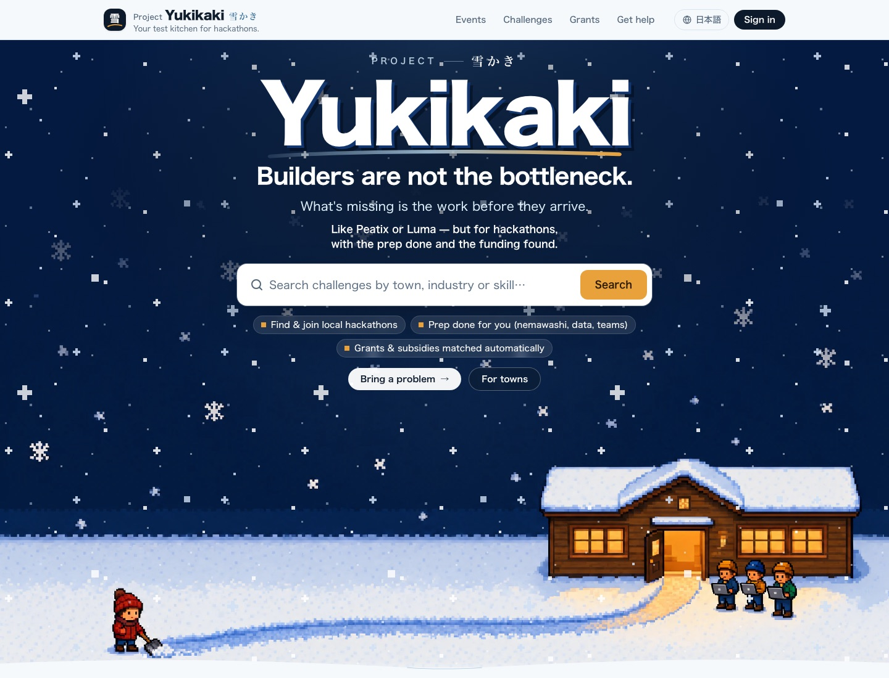
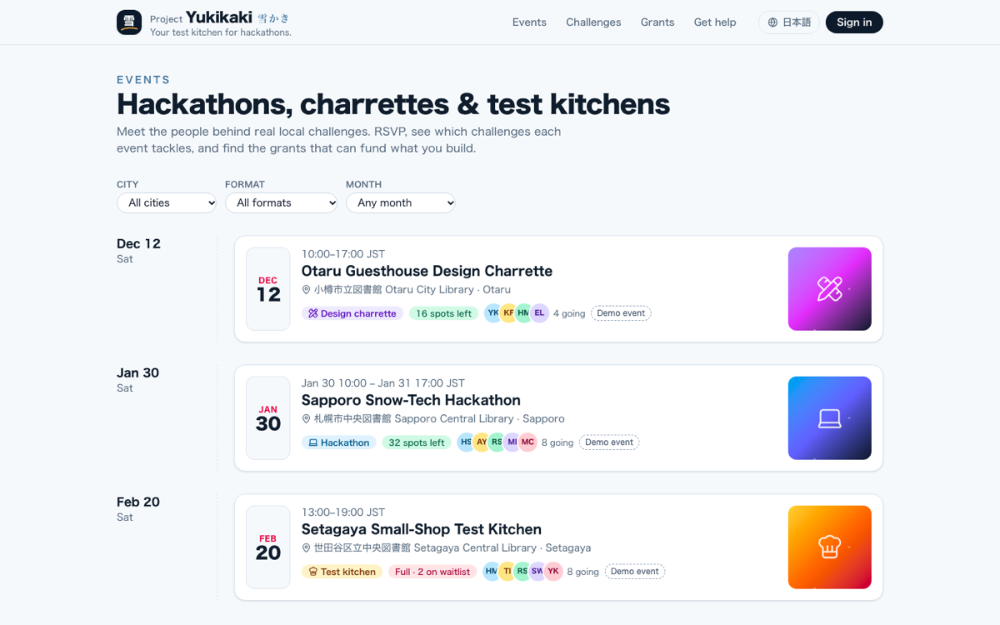
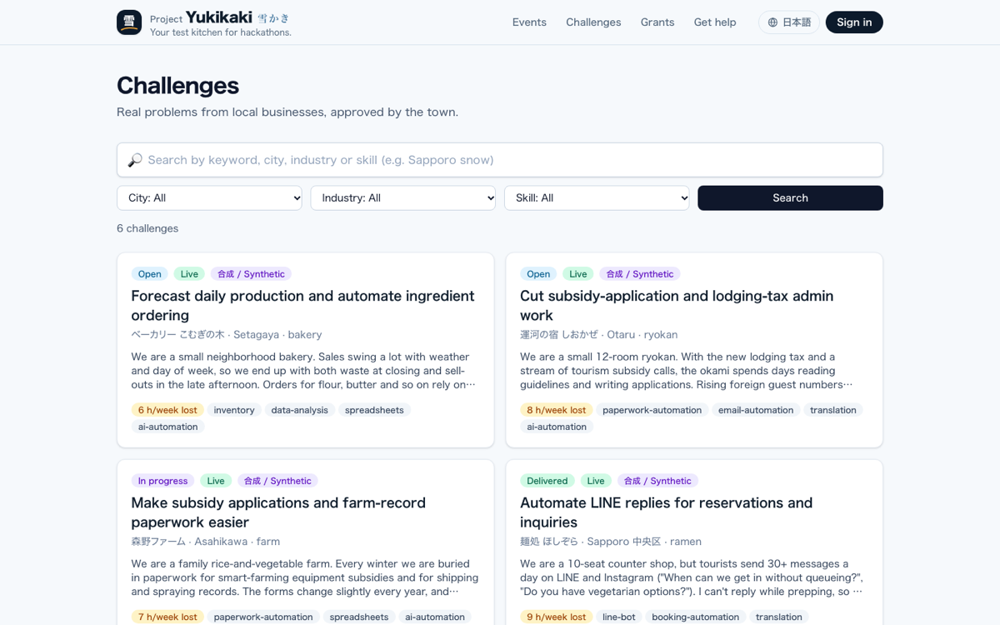
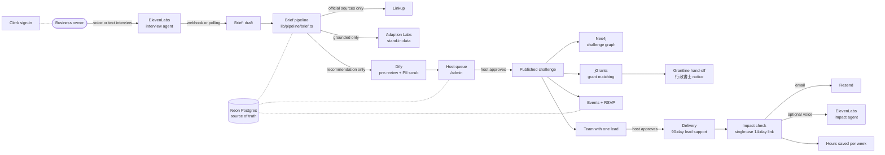
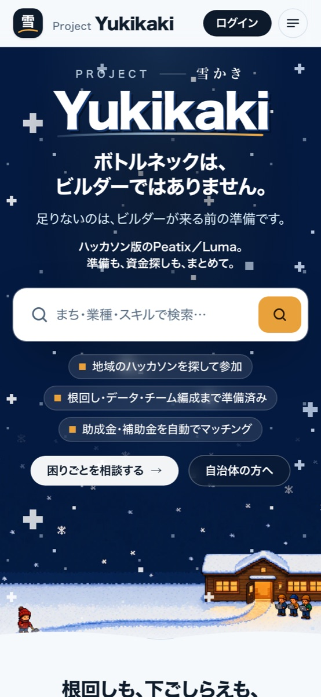
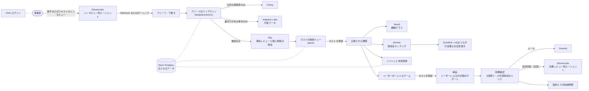

# Yukikaki 雪かき

### AI-native hackathons for Sapporo and beyond.

**From idea to working prototype — fast.**

*Your test kitchen for hackathons.* · Like Peatix or Luma — but for hackathons, with the prep done and the funding found.

**English** · [日本語](#日本語)

[](LICENSE)
[](https://nextjs.org)
[](https://github.com/amomusik/project-yukikaki/actions/workflows/ci.yml)



Yukikaki speeds up the trip from a local problem to a working prototype. It finds the problem, does the prep, lines up the funding and hands builders a challenge they can start on in the first hour.

**What "AI-native" means here:** AI agents do the legwork at every step (interviews, research, data, matching, grants), and people make every call.

---

## Why

Builders are not the bottleneck. Students and local developers can already automate a lot of a small business's busywork with AI tools. What is missing is the work *before* they arrive: a clear problem from a real owner, data they are allowed to use, the people who have to say yes (*nemawashi*, 根回し), a venue, funding and a team that fits. That's the *mise en place*, and it rarely gets done.

In a Hokkaido winter, someone shovels the path before anyone else can get through. That is *yukikaki* (雪かき): necessary work nobody wants to do. Yukikaki does that work for the people who build. A short voice interview with a shop owner becomes a grounded, reviewed challenge. A town host approves it. A team builds it and the lead supports the owner for 90 days. Then the owner reports how many hours a week it actually saves.

The project is MIT-licensed so **any town can fork it** and run it with its own city data, hosts and partners.

## What it does

Everything below exists in the code today. The [Roadmap](#roadmap) lists what is planned but not built.

| Feature | What happens | Where in the code |
|---|---|---|
| **Events + RSVP** | Public listing of hackathons, design charrettes and test-kitchen sessions, filtered by city, format and month. RSVP as participant, mentor or observer. When an event is full you join a waitlist, and you're promoted automatically when a seat frees up. RSVP emails, `.ics` calendar export and share links. Each event page shows its linked challenges and the top grant matches for them. Only hosts can create, edit, publish or cancel events. | `app/[locale]/events`, `lib/events`, `app/api/events` |
| **Challenges from voice interviews** | A business owner does a ~10-minute voice interview with an ElevenLabs agent, or fills in a text form. The conversation's data-collection fields become a draft brief in Japanese and English. | `app/[locale]/interview`, `lib/integrations/elevenlabs.ts`, `lib/briefs.ts` |
| **Grounding in official sources only** | Linkup searches are limited to `go.jp`, `lg.jp`, `or.jp`, `ac.jp` and the city's own site. The search cascades from exact city to analog cities and adjacent industries, then national statistics. Blogs, personal pages and other municipalities' sites are rejected. | `lib/grounding/search.ts`, `lib/grounding/city-profiles.ts` |
| **Synthetic stand-in data** | When a brief is grounded, Adaption Labs generates fictional Japanese stand-in rows from those sources, so builders never touch the owner's private data. Ungrounded briefs get no synthetic data. | `lib/integrations/adaption.ts`, `lib/datasets/store.ts` |
| **AI pre-review, host approval, PII scrubbing** | A Dify workflow pre-reviews each brief: privacy, feasibility, grounding, bilingual editing and house rules. A privacy step flags personal data. Only values that literally appear in the input count, and those values (plus romanised forms of names) are scrubbed from the brief text and issues. If PII was found the recommendation is forced to "revise". AI only recommends: approval goes through a single host-only code path with an audit log. | `scripts/build-dify.ts`, `dify/*.yml`, `lib/integrations/dify.ts`, `lib/decide.ts` |
| **Teams with one named lead** | Builders form a team on an approved challenge. Whoever creates it is the lead and the owner's single point of contact. The database allows exactly one lead per team, and the lead role can be transferred. Dify pre-reviews the team; the host decides. | `lib/teams.ts`, `app/[locale]/teams` |
| **Delivery + 90-day lead support** | The lead submits the delivery (summary, links, handover notes) and is recorded as the support contact for 90 days. | `app/[locale]/teams/[id]/deliver` |
| **Impact checks** | The host sends a single-use link that expires after 14 days. The owner answers a short questionnaire (optionally by voice, with a second ElevenLabs agent). The admin Impact tab totals hours saved per week. If email can't be sent, the link appears in `/admin` with a Copy button. | `lib/feedback.ts`, `app/[locale]/feedback/[token]` |
| **Grants & subsidies, auto-matched** | When a host approves a challenge, open public programmes are matched from the official **jGrants** API (デジタル庁; no key needed), with optional Linkup enrichment for municipal programmes. Matches show deadline, amount and rate and link to **Grantline** for eligibility checks. Every grant view carries the 行政書士 notice: Yukikaki only discovers and matches programmes. Since January 2026, preparing grant applications for a fee is reserved to licensed administrative scriveners (行政書士), so the host files with a licensed professional. | `lib/grants`, `app/[locale]/grants`, `app/api/grants` |
| **Challenge graph** | Neo4j links challenges, businesses, cities, datasets, skills, builders, teams, deliveries, stakeholders, venues and funders. It suggests builders by skill (with a SQL fallback). Hosts can view the graph at `/admin/graph`. | `lib/graph`, `components/graph-view.tsx` |
| **English + Japanese** | Every page is available at `/ja` (default) and `/en`, and every UI string exists in both `messages/en.json` and `messages/ja.json`. | `i18n/`, `messages/` |

The landing page also has an interactive **test kitchen** walkthrough (`components/landing/kitchen-quest.tsx`) and a **formats** explorer (`components/landing/formats-harness.tsx`).

<p>
  
  
</p>

## Formats

**One harness, any format.** Every format gets the same prep, the same guardrails and the same follow-through. Events are created with one of three formats (`event_format` enum: `hackathon`, `charrette`, `test_kitchen`).

| Format | Who · how long | Output | Before | During | After |
|---|---|---|---|---|---|
| **Hackathon** | Builders · 1–3 days | Working prototypes | Briefs, data, buy-in, venue, funding and matched teams | Owners on hand to answer questions. AI drafts; the host approves | Delivery, 90-day lead support and an impact check |
| **Design charrette** (a hands-on design day with residents) | Residents + stakeholders · about 1 day | A shared plan and priorities | Problems from interviews, cited local data, the right people invited | Ideas captured and sorted into a draft plan for the host to approve | Priorities turned into briefs for the next hackathon or test kitchen |
| **Test kitchen** | Owners + builders · ongoing | Small prototypes tried in real work | One brief at a time, prepped with stand-in data | The owner tries it in a normal week; the lead adjusts | An impact check decides: keep, rework or drop |

## Architecture

A single Next.js 15 app (App Router, TypeScript, React 19, Tailwind CSS 4, next-intl, Drizzle ORM). Pages are under `app/[locale]/…`, API routes under `app/api/…`, business logic under `lib/`. More detail: [docs/architecture.md](docs/architecture.md).



### Partner tools

Each tool has one job. Every external call goes through one guard (`withFallback` in `lib/integrations/_guard.ts`), which applies a timeout and logs a `service_events` row.

| Tool | Job in Yukikaki |
|---|---|
| [ElevenLabs](https://elevenlabs.io) | Voice interview → challenge brief; voice impact review |
| [Linkup](https://www.linkup.so) | Data and context search restricted to official Japanese sources, with citations; optional municipal grant enrichment |
| [Neo4j](https://neo4j.com) (Aura Free) | Challenge graph and builder suggestions (a projection; always rebuildable) |
| [Dify](https://dify.ai) | Approval workflows: brief and team pre-review with PII scrubbing (recommendation only) |
| [Neon](https://neon.tech) | Postgres records — the source of truth |
| [Adaption Labs](https://adaptionlabs.ai) | Synthetic Japanese stand-in data generated from grounding sources |
| [Clerk](https://clerk.com) | Sign-in; users are mirrored into Postgres on first request |
| [Resend](https://resend.com) | Impact-check, RSVP and waitlist emails |
| [jGrants](https://www.jgrants-portal.go.jp) | Official public subsidy API (Digital Agency) for grant matching; no key required |

### Data model

Drizzle schema in `lib/db/schema.ts`; migrations in `drizzle/`.

| Area | Tables |
|---|---|
| People | `users` (Clerk mirror; role `business` / `student` / `host`), `businesses` |
| Challenges | `briefs` (bilingual content, status, grounding level, AI review), `data_sources` (live and synthetic sources per brief) |
| Teams & delivery | `teams`, `team_members` (partial unique index: one lead per team), `deliveries` (support contact + `support_until`) |
| Impact | `feedback_tokens` (HMAC-hashed single-use links), `evaluations` |
| Town | `entities` (stakeholders, venues, funders) |
| Funding | `grant_matches` (jGrants / Linkup matches per brief) |
| Events | `events` (format, status, capacity, demo flag), `event_challenges`, `event_rsvps` (role + going / waitlist / cancelled) |
| Roadmap | `waitlist` (one shared waitlist for the coming-soon features) |
| Audit | `decisions` (every host decision), `service_events` (one row per external call) |

Status machines live in `lib/workflow/status.ts`. Briefs go `draft → enriching → in_review → approved → in_progress → delivered → evaluated` (plus `rejected`, which can be resubmitted). Teams go `pending → approved | rejected`, then `approved → delivered`.

### Rules the code enforces

1. **Live-only mode.** With `REQUIRE_LIVE_SERVICES=true`, the pipeline never substitutes pre-baked data. A failed live call is written to the brief's AI-review issues for the host to see, and `pnpm check:services` exits non-zero unless all 8 services are live. Without it (local development only), a missing service switches to a documented, labelled fallback.
2. **The host decides.** AI only recommends. The only code path that approves or rejects a brief or team is `decide()` in `lib/decide.ts`, which checks the host role, validates the transition and writes an audit row.
3. **Cite or say you can't.** Only official sources ground a brief, and every source is stored with its URL. If nothing official is found, the brief is marked `ungrounded`, no synthetic data is generated, and the host is told.
4. **Private data stays private.** Builders work on synthetic stand-in data. Verified PII is scrubbed before a brief is published, and impact-check tokens are stored only as HMAC hashes.

Neon is the source of truth; Neo4j is a projection that `pnpm graph:rebuild` can always rebuild.

## Quick start

### Prerequisites

- Node.js 22 (the version CI uses) and [pnpm](https://pnpm.io)
- For a full live setup, accounts with Clerk, Neon, Neo4j Aura, ElevenLabs, Linkup, Dify, Adaption Labs and Resend (all have free tiers or trials)

For local development, only a database is a hard dependency. Without `DATABASE_URL` the app uses an embedded PGlite database in `./.data/pglite`. Without Clerk keys it runs in Clerk's keyless dev mode. Each other service falls back as described in [docs/architecture.md](docs/architecture.md) until you add its key.

### 1. Clone and install

```bash
git clone https://github.com/amomusik/project-yukikaki.git
cd project-yukikaki
pnpm install
cp .env.example .env.local
```

### 2. Fill in `.env.local`

Every variable in [`.env.example`](.env.example):

| Variable | What it's for | Where to get it |
|---|---|---|
| `APP_URL` | Public base URL, used in impact links and emails | `http://localhost:3100` locally; your domain in production |
| `HOST_EMAILS` | Comma-separated emails that become town hosts (admins) on first sign-in | Your hosts' addresses |
| `FEEDBACK_TOKEN_SECRET` | Signs one-time impact-check links (32+ chars; required in production) | `openssl rand -hex 32` |
| `REQUIRE_LIVE_SERVICES` | `true` = live-only mode (no pre-baked fallbacks) | Set `true` for demos and production |
| `NEXT_PUBLIC_CLERK_PUBLISHABLE_KEY` | Clerk publishable key (leave empty locally for keyless mode) | [dashboard.clerk.com](https://dashboard.clerk.com) |
| `CLERK_SECRET_KEY` | Clerk secret key | [dashboard.clerk.com](https://dashboard.clerk.com) |
| `DATABASE_URL` | Neon Postgres connection string (empty = local PGlite) | [console.neon.tech](https://console.neon.tech) |
| `NEO4J_URI` | Neo4j Aura URI, `neo4j+s://<instance-id>.databases.neo4j.io` | [console.neo4j.io](https://console.neo4j.io) |
| `NEO4J_USERNAME` | Neo4j username (on current Aura Free this is the instance id) | Aura credentials screen |
| `NEO4J_PASSWORD` | Neo4j password (shown only once) | Aura credentials screen |
| `ELEVENLABS_API_KEY` | ElevenLabs API key | [elevenlabs.io](https://elevenlabs.io/app/agents) |
| `ELEVENLABS_INTERVIEW_AGENT_ID` | Interview agent id | Written by `pnpm setup:elevenlabs` |
| `ELEVENLABS_IMPACT_AGENT_ID` | Impact-review agent id | Written by `pnpm setup:elevenlabs` |
| `ELEVENLABS_WEBHOOK_SECRET` | Verifies the post-call webhook (production only; local dev polls) | ElevenLabs webhook settings |
| `LINKUP_API_KEY` | Linkup search | [app.linkup.so](https://app.linkup.so) |
| `DIFY_API_URL` | Dify API base (default `https://api.dify.ai`) | Dify Cloud or your self-hosted URL |
| `DIFY_BRIEF_REVIEW_KEY` | API key of the imported brief-review app | Dify → app → API Access |
| `DIFY_TEAM_REVIEW_KEY` | API key of the imported team-review app | Dify → app → API Access |
| `ADAPTION_API_KEY` | Adaption Labs API key | [adaptionlabs.ai](https://adaptionlabs.ai) |
| `ADAPTION_API_URL` | Override only if your account uses another API host | Adaption Labs |
| `RESEND_API_KEY` | Resend API key | [resend.com](https://resend.com) |
| `EMAIL_FROM` | Sender, e.g. `"Yukikaki <noreply@mail.yourtown.example.jp>"` (must be on a verified domain) | Resend → Domains |

### 3. Set up each service

- **Clerk.** Create an application and copy both keys (or leave them empty for local keyless mode). With the Clerk CLI: `clerk apps create`, then `clerk env pull`.
- **Neon.** Create a project in region **aws-ap-southeast-1** (Singapore, the closest to Japan) and copy the connection string.
- **Neo4j Aura Free.** In the Aura console, **Create instance → Free**. Copy the password before closing the credentials screen, because it is shown only once. An idle Free instance pauses after a few days (resume it from the console) and is deleted after 30 days paused. Since Neon is the source of truth, `pnpm graph:rebuild` restores the graph onto a new instance.
- **ElevenLabs.** Add `ELEVENLABS_API_KEY`, then run `pnpm setup:elevenlabs`. This creates or updates both voice agents from [docs/elevenlabs-agents.md](docs/elevenlabs-agents.md) and writes their ids into `.env.local`.
- **Dify.** Run `pnpm dify:build` to regenerate `dify/brief-review.yml` and `dify/team-review.yml`. In Dify, go to **Studio → Create → Import DSL** for each file, **Publish**, then create an API key under **API Access** and paste it into `DIFY_BRIEF_REVIEW_KEY` / `DIFY_TEAM_REVIEW_KEY`. Verify with `pnpm smoke:dify` (uses a few Dify credits).
- **Linkup.** Create an API key.
- **Adaption Labs.** Create an API key.
- **Resend.** Add a sending subdomain, create the DKIM, SPF and CNAME DNS records Resend shows, and wait until it is **Verified**. The test sender `onboarding@resend.dev` only delivers to the account owner, so it can't reach business owners.

### 4. Database, seed, check, run

```bash
pnpm db:push            # apply migrations
pnpm seed               # demo users, businesses, briefs, teams, local entities (+ seed/prebaked demo data)
pnpm seed:events        # optional: three demo events linked to the seeded challenges
pnpm graph:rebuild      # project published records into Neo4j
pnpm check:services     # one line per service; in live-only mode every line must be ✓
pnpm dev --port 3100    # port 3000 is often taken by other local tools
```

Open <http://localhost:3100/ja> (or `/en`). Sign in with an address from `HOST_EMAILS` to become a host and open `/admin`. After an interview, `pnpm tsx scripts/inspect-latest.ts` prints the newest brief's pipeline output and the service calls made for it.



## Run it in your town

1. **City profile.** Add a row for your town to `CITY_PROFILES` in `lib/grounding/city-profiles.ts`: snowfall, January temperature, population, coastal, tourism, aging ratio and the city's official site domain. This finds your analog cities and lets grounding accept your city's own site.
2. **Industries.** If your local industries are missing, add them to `lib/grounding/industry-neighbors.ts`, which provides the adjacent industries for the grounding cascade and grant keywords.
3. **Seed entities.** Edit `seed/seed.json` (shape in `lib/seed-schema.ts`), especially `entities`: the stakeholders, venues and funders in your town. Use the city name exactly as in `city-profiles.ts`. Then re-run `pnpm seed` and `pnpm graph:rebuild`.
4. **Events.** Sign in as a host and create events at `/events/new`: pick a format, venue, capacity and the challenges the event tackles. `scripts/seed-events.ts` shows the shape if you'd rather script demo events.
5. **Deploy.** See [Deploy](#deploy) and the [operator guide](docs/operator-guide.md) for your hosts.

## Scripts

All scripts in `package.json`:

| Script | What it does |
|---|---|
| `pnpm dev` | Next.js dev server (use `pnpm dev --port 3100`) |
| `pnpm build` | Production build |
| `pnpm start` | Serve the production build |
| `pnpm lint` | ESLint |
| `pnpm typecheck` | `tsc --noEmit` |
| `pnpm test` | All Vitest suites (unit, integration, contract) |
| `pnpm test:unit` | Pure functions, no database |
| `pnpm test:integration` | Database-backed tests on in-memory PGlite |
| `pnpm test:contract` | Zod schemas against recorded partner-API fixtures |
| `pnpm test:coverage` | All suites with V8 coverage of `lib/` |
| `pnpm test:e2e` | Playwright against a production build on port `E2E_PORT` (default 3200); set `E2E_BASE_URL` to test a running server |
| `pnpm db:generate` | Generate a SQL migration from `lib/db/schema.ts` (Drizzle Kit) |
| `pnpm db:push` | Apply the migrations in `drizzle/` to `DATABASE_URL` (or local PGlite) |
| `pnpm seed` | Load synthetic demo content (`seed/seed.json` + `seed/prebaked/*.json`); real records are never touched |
| `pnpm seed:events` | Replace the three demo events (`is_demo`) linked to seeded challenges; run `pnpm seed` first |
| `pnpm prebake` | Run the live pipeline for seeded briefs and save `seed/prebaked/*.json` (`--only <slug>` for one) |
| `pnpm graph:rebuild` | Wipe Neo4j and rebuild the challenge graph from the database |
| `pnpm check:services` | Check every service; non-zero exit if the database fails, or in live-only mode if any service isn't live |
| `pnpm dify:build` | Regenerate `dify/brief-review.yml` and `dify/team-review.yml` from `scripts/build-dify.ts` |
| `pnpm smoke:dify` | Run both published Dify workflows once with a demo brief |
| `pnpm setup:elevenlabs` | Create/update both ElevenLabs agents and write their ids to `.env.local` |
| `pnpm simulate:interview` | Live, microphone-free test of both voice agents (agent-to-agent text conversation + real post-call analysis) |
| `pnpm vercel:env` | Write a mode-600 script of `vercel env add` commands from `.env.local` (prints names only, never values) |
| `pnpm knip` | Unused files, exports and dependencies |
| `pnpm audit:orphans` | Static orphan audit → `docs/audit/orphans-<date>.{md,json}` |
| `pnpm evals` | Live AI evals (prints a cost estimate; runs only with `--yes`) |

## Testing & quality

- **Unit / integration / contract.** `pnpm test` runs three Vitest projects defined in `vitest.config.mts`. Unit tests cover pure logic, including the Dify PII scrubber, which runs the real Python node. Integration tests use in-memory PGlite with the real schema and queries. Contract tests check zod schemas against recorded fixtures in `tests/fixtures/` (see its README), so a partner API change shows up as a failing test.
- **End-to-end.** `pnpm test:e2e` builds and serves a production snapshot, then runs `e2e/flow.spec.ts` (the full owner → host → team → delivery → impact flow; needs Clerk test keys and live partner keys).
- **Accessibility.** `pnpm test:e2e e2e/a11y.spec.ts` runs axe (WCAG 2.1 A/AA) on the public pages and fails on serious or critical violations.
- **Coverage.** `pnpm test:coverage` reports V8 coverage for `lib/`. Network adapters in `lib/integrations/` are covered by contract fixtures and evals instead.
- **Evals (opt-in, costs credits).** `pnpm evals` covers four suites: `brief-review`, `grounding`, `grants` and `interview`. It calls live partner APIs, so it prints a cost estimate and exits without running anything unless you pass `--yes` (`--suite=…`, `--runs=N`, `--limit=N`). Results go to `evals/results/`. In GitHub Actions it only runs manually (`.github/workflows/evals.yml`).
- **Orphan audit.** `pnpm audit:orphans` statically finds dead code, unused i18n keys, undeclared env vars, unused DB columns, unreachable state transitions and more, and writes a report to `docs/audit/`. It is read-only and never prints `.env.local` values.
- **CI.** `.github/workflows/ci.yml` runs on every push and pull request. It runs typecheck, lint, knip and the orphan audit (the last two as warnings for now), plus a migrations-match-schema check. It then runs the unit, integration and contract suites with coverage, and Playwright (accessibility; the full flow only when partner secrets are configured). E2E is skipped cleanly when the repo has no Clerk secrets. CI is hermetic: PGlite instead of Neon and no live partner calls by default.

## Deploy

The app targets **Vercel** with functions pinned to **`hnd1` (Tokyo)** in `vercel.json`, and Neon in `aws-ap-southeast-1`. On Vercel, `DATABASE_URL` is required (PGlite refuses to start on a read-only filesystem). Set `REQUIRE_LIVE_SERVICES=true` in production.

```bash
vercel link                                             # once
pnpm vercel:env --app-url https://yukikaki.example.jp   # add --env preview for Preview
```

`pnpm vercel:env` writes a shell script of `vercel env add` commands (mode 600; values are never printed). Run it, then delete it. Full steps, including the ElevenLabs webhook, the Clerk production instance, the Resend domain and function durations, are in [docs/deploy.md](docs/deploy.md).

## Roadmap

**Coming soon. None of these are live yet.** The landing page has one shared waitlist for them (`waitlist` table, `lib/waitlist.ts`, `components/landing/party-builder.tsx`):

- **Bring any team: AI helper robots fill in the rest.** A few students, a town office, a shop owner and a friend, or a weekend hackathon squad. AI helpers will cover the prep roles your team is missing: Researcher, Scout, Fundraiser, Diplomat, Translator and Data chef. The landing page has a preview that runs only in your browser with a fixed mapping. It is not the live product.
- **Virtual product manager.** An AI PM robot that checks in with the owner, team lead, members and host on what's next, spots blockers, nudges deadlines and suggests the next step. It proposes; people decide.
- **Points & rewards.** Points and badges for joining more hackathons, delivering prototypes, mentoring and real impact (hours saved), with a season leaderboard and perks.

The same guardrails will apply: AI proposes and people decide, it cites sources or says it can't, and private data stays private.

## Project structure

```
app/            Next.js App Router: pages under [locale]/ (events, challenges, grants, interview,
                teams, admin, feedback, me, onboarding) and route handlers under api/
components/     Shared UI; components/landing/ holds the landing sections (hero, test kitchen,
                formats harness, roadmap party builder)
data/           Generated synthetic stand-in datasets (data/synthetic/*.json)
dify/           Importable Dify workflows (brief-review.yml, team-review.yml)
docs/           Architecture, deploy, operator guide, ElevenLabs agents, demo script, audit reports,
                screenshots
drizzle/        SQL migrations (applied by pnpm db:push)
e2e/            Playwright specs (full flow, accessibility) and the production-build server script
emails/         Bilingual email templates (impact check, waitlist confirmation)
evals/          Opt-in live AI evals: suites, datasets, results
i18n/           next-intl routing (ja default, en)
lib/            Business logic: pipeline, grounding, integrations, events, grants, graph, db, auth
messages/       UI strings (en.json, ja.json)
public/         Static assets, including the 8-bit illustrations
scripts/        CLI scripts behind the package.json commands
seed/           Demo seed data (seed.json + prebaked/*.json)
tests/          Vitest suites (unit, integration, contract) and recorded fixtures
.github/        CI and manual eval workflows
```

## Contributing

Contributions from any town are welcome. See [CONTRIBUTING.md](CONTRIBUTING.md) for setup, branch and PR conventions, required tests and the i18n rule (every string in English and Japanese).

## Security

Please report vulnerabilities privately as described in [SECURITY.md](SECURITY.md), which also covers secret handling and the PII policy.

## License

MIT — see [LICENSE](LICENSE). Any town can fork it.

## Credits

Built at Hack Hokkaido Build Week, Sapporo, November 2026 by Team Snowball.

Powered by [ElevenLabs](https://elevenlabs.io) · [Linkup](https://www.linkup.so) · [Neo4j](https://neo4j.com) · [Dify](https://dify.ai) · [Neon](https://neon.tech) · [Adaption Labs](https://adaptionlabs.ai) · [Clerk](https://clerk.com) · [Resend](https://resend.com) · [jGrants](https://www.jgrants-portal.go.jp) · [Grantline](https://grantline.foundrylabs.co.jp/en/grants)

---

## 日本語

### 札幌から全国へ、AIネイティブなハッカソンを。

**アイデアを、すばやく現実に。**

*ハッカソンのための、まちのテストキッチン。* · ハッカソン版の Peatix／Luma。準備も、資金探しも、まとめて。


Yukikaki は、地域の困りごとが動く試作品になるまでの道のりを短くします。課題を見つけ、下ごしらえを済ませ、資金の当てをつけて、ビルダーが最初の1時間から取りかかれる課題を手渡します。

**ここでいう「AIネイティブ」とは：** インタビュー、調査、データ、マッチング、助成金探しまで、すべての段階で AI エージェントが手を動かし、判断はすべて人が行うということです。

### なぜ雪かきなのか

ボトルネックは、ビルダーではありません。学生や地元の開発者は、小さなお店の面倒な作業の多くを、すでに AI ツールで自動化できます。足りないのは、ビルダーが来る**前**の仕事です。実在する事業者からの明確な課題、使ってよいデータ、首を縦に振ってもらう必要がある人たちへの根回し、会場、資金、そして相性のよいチーム。つまり「下ごしらえ（ミザンプラス）」ですが、これはほとんど誰も手をつけません。

北海道の冬には、誰かが先に雪をかいて、みんなが通れる道をつくります。それが「雪かき」です。必要だけれど、誰もやりたがらない仕事です。Yukikaki は、つくる人たちのためにその役目を担います。事業者への短い音声インタビューが、裏付けのある審査済みの課題（チャレンジ）になり、自治体のホストが承認します。チームが解決策をつくり、リーダーが90日間サポートします。最後に、毎週実際に何時間減ったかを事業者に答えてもらいます。

MIT ライセンスで公開しているので、**どのまちでもフォークして**、自分のまちのデータ・ホスト・パートナーで運用できます。

### できること

以下はすべて、現在のコードに実装されている機能です。計画中でまだ実装されていないものは[ロードマップ](#ロードマップ)にまとめています。

| 機能 | 内容 | コードの場所 |
|---|---|---|
| **イベントと参加登録** | ハッカソン、デザイン・シャレット、テストキッチンの公開一覧を、まち・形式・月で絞り込めます。参加者・メンター・見学者として参加登録でき、満席の場合はキャンセル待ちに入り、空きが出ると自動で繰り上がります。登録確認メール、`.ics` カレンダー出力、共有リンクがあります。各イベントページには、紐づいた課題と、その課題に合う助成金の上位候補が表示されます。イベントの作成・編集・公開・中止はホストだけが行えます。 | `app/[locale]/events`、`lib/events`、`app/api/events` |
| **音声インタビューから課題へ** | 事業者が ElevenLabs のエージェントと約10分の音声インタビューを行います（テキスト入力も可）。会話のデータ収集項目から、日英の下書きブリーフが作られます。 | `app/[locale]/interview`、`lib/integrations/elevenlabs.ts`、`lib/briefs.ts` |
| **公的な情報源だけで裏付け** | Linkup の検索は `go.jp`・`lg.jp`・`or.jp`・`ac.jp` と市の公式サイトに限定しています。そのまち → 類似都市・近い業種 → 全国統計の順に広げ、ブログや個人ページ、別の自治体のサイトは除外します。 | `lib/grounding/search.ts`、`lib/grounding/city-profiles.ts` |
| **合成の代替データ** | 裏付けが取れたブリーフについてだけ、Adaption Labs がその情報源をもとに架空の日本語データを生成します。ビルダーが事業者の個人データに触れることはありません。裏付けのないブリーフには合成データを作りません。 | `lib/integrations/adaption.ts`、`lib/datasets/store.ts` |
| **AI の事前レビュー、ホストの承認、個人情報の除去** | Dify のワークフローが、各ブリーフを事前レビューします（個人情報・実現可能性・裏付け・日英の編集・ハウスルール）。個人情報チェックでは、入力に文字どおり含まれている値だけを個人情報として扱い、その値（人名はローマ字表記も）をブリーフ本文と指摘事項から機械的に取り除きます。個人情報が見つかった場合、推奨は必ず「要修正」になります。AI は推奨するだけで、承認はホスト専用の一つの処理を通り、判断記録が残ります。 | `scripts/build-dify.ts`、`dify/*.yml`、`lib/integrations/dify.ts`、`lib/decide.ts` |
| **リーダーが一人いるチーム** | 承認済みの課題に対してビルダーがチームを作ります。作成者がリーダーとなり、事業者の唯一の窓口になります。データベース上、リーダーは各チームにちょうど一人で、交代もできます。Dify がチームを事前レビューし、ホストが決定します。 | `lib/teams.ts`、`app/[locale]/teams` |
| **納品と90日間のサポート** | リーダーが納品（概要・リンク・引き継ぎメモ）を提出し、90日間のサポート窓口として記録されます。 | `app/[locale]/teams/[id]/deliver` |
| **効果確認** | ホストが1回限り・14日間有効のリンクを送ります。事業者は短いアンケートに答えます（2つ目の ElevenLabs エージェントで音声回答も可）。管理画面の「インパクト」タブで週あたりの削減時間を集計します。メールを送れない場合は、`/admin` にコピーボタン付きでリンクを表示します。 | `lib/feedback.ts`、`app/[locale]/feedback/[token]` |
| **助成金・補助金の自動マッチング** | ホストが課題を承認すると、公式の **jGrants** API（デジタル庁、キー不要）から募集中の制度をマッチングします。市区町村の制度は Linkup で補うこともできます。締切・金額・補助率を表示し、応募資格の確認は **Grantline** へおつなぎします。助成金を表示する画面には必ず行政書士に関する注意書きを載せています。Yukikaki が行うのは制度の発見とマッチングだけです。2026年1月以降、報酬を得て補助金の申請書類を作成することは行政書士の独占業務となったため、申請はホストが有資格者と行います。 | `lib/grants`、`app/[locale]/grants`、`app/api/grants` |
| **課題グラフ** | Neo4j が、課題・事業者・まち・データセット・スキル・ビルダー・チーム・納品・関係者・会場・資金提供者をつなぎます。スキルからビルダーを提案し（SQL による代替あり）、ホストは `/admin/graph` でグラフを確認できます。 | `lib/graph`、`components/graph-view.tsx` |
| **日本語と英語** | すべてのページが `/ja`（既定）と `/en` で表示でき、UI の文言はすべて `messages/en.json` と `messages/ja.json` の両方にあります。 | `i18n/`、`messages/` |

トップページには、インタラクティブな**テストキッチン**の紹介（`components/landing/kitchen-quest.tsx`）と、**開催形式**を見比べられるセクション（`components/landing/formats-harness.tsx`）もあります。

### 開催形式

**ひとつの仕組みで、どんな形式にも。** どの形式でも、同じ下ごしらえ、同じルール、同じフォローアップを提供します。イベントは3つの形式（`event_format`：`hackathon`・`charrette`・`test_kitchen`）から選んで作成します。

| 形式 | 参加者・期間 | 成果 | 事前 | 当日 | 事後 |
|---|---|---|---|---|---|
| **ハッカソン** | ビルダー・1〜3日 | 動く試作品 | ブリーフ、データ、根回し、会場、資金、チーム編成 | 事業者が質問に答えられるよう同席。AI が下書きし、ホストが承認 | 納品、リーダーによる90日間のサポート、効果確認 |
| **デザイン・シャレット**（住民と一緒に手を動かす設計の日） | 住民と関係者・約1日 | 共有できる計画と優先順位 | インタビューで集めた課題、出典つきの地域データ、適切な人への声かけ | アイデアを記録・整理し、ホストが承認する計画案に | 優先順位を、次のハッカソンやテストキッチンのブリーフに |
| **テストキッチン** | 事業者とビルダー・継続 | 実際の業務で試す小さな試作品 | ブリーフを一つずつ、代替データで準備 | 事業者がふだんの1週間で試し、リーダーが調整 | 効果確認で「続ける・作り直す・やめる」を判断 |

### アーキテクチャ

Next.js 15 のアプリ1つで構成しています（App Router、TypeScript、React 19、Tailwind CSS 4、next-intl、Drizzle ORM）。ページは `app/[locale]/…`、API は `app/api/…`、業務ロジックは `lib/` にあります。詳しくは [docs/architecture.md](docs/architecture.md) をご覧ください。



#### パートナーツール

それぞれのツールが一つの役割を担います。外部サービスの呼び出しはすべて一つのガード（`lib/integrations/_guard.ts` の `withFallback`）を通り、タイムアウトを適用して `service_events` に記録します。

| ツール | Yukikaki での役割 |
|---|---|
| [ElevenLabs](https://elevenlabs.io) | 音声インタビュー → 課題ブリーフ、音声による効果レビュー |
| [Linkup](https://www.linkup.so) | 日本の公的な情報源に限定した、出典つきのデータ・背景検索。市区町村の助成制度の補完（任意） |
| [Neo4j](https://neo4j.com)（Aura Free） | 課題グラフとビルダー提案（いつでも再構築できる投影） |
| [Dify](https://dify.ai) | 承認ワークフロー：ブリーフとチームの事前レビュー、個人情報の除去（推奨のみ） |
| [Neon](https://neon.tech) | Postgres の記録（正となるデータ） |
| [Adaption Labs](https://adaptionlabs.ai) | 裏付けの情報源から作る日本語の合成代替データ |
| [Clerk](https://clerk.com) | ログイン。初回アクセス時にユーザーを Postgres に反映 |
| [Resend](https://resend.com) | 効果確認・参加登録・ウェイトリストのメール |
| [jGrants](https://www.jgrants-portal.go.jp) | デジタル庁の公式補助金 API（キー不要）による助成金マッチング |

#### データモデル

Drizzle のスキーマは `lib/db/schema.ts`、マイグレーションは `drizzle/` にあります。

| 分類 | テーブル |
|---|---|
| 人 | `users`（Clerk のミラー。役割は `business`／`student`／`host`）、`businesses` |
| 課題 | `briefs`（日英の内容・状態・裏付けレベル・AI レビュー）、`data_sources`（ブリーフごとの実データ・合成データ） |
| チームと納品 | `teams`、`team_members`（部分ユニークインデックスでリーダーは一人）、`deliveries`（サポート窓口と `support_until`） |
| 効果 | `feedback_tokens`（HMAC でハッシュ化した1回限りのリンク）、`evaluations` |
| まち | `entities`（関係者・会場・資金提供者） |
| 資金 | `grant_matches`（ブリーフごとの jGrants／Linkup の候補） |
| イベント | `events`（形式・状態・定員・デモフラグ）、`event_challenges`、`event_rsvps`（役割と参加／キャンセル待ち／取消） |
| ロードマップ | `waitlist`（近日公開機能の共通ウェイトリスト） |
| 監査 | `decisions`（ホストの全判断）、`service_events`（外部呼び出しごとに1行） |

状態遷移は `lib/workflow/status.ts` に定義しています。ブリーフは `draft → enriching → in_review → approved → in_progress → delivered → evaluated` と進み、`rejected` になった場合は再提出できます。チームは `pending → approved | rejected` の後、`approved → delivered` と進みます。

#### コードで守っているルール

1. **ライブ専用モード。** `REQUIRE_LIVE_SERVICES=true` のとき、パイプラインは事前取得データで代用しません。外部呼び出しが失敗すると、その内容はブリーフの AI レビューの指摘事項に書き込まれ、ホストが確認できます。`pnpm check:services` は、8つのサービスすべてが稼働していないとエラーで終了します。このモードを使わない場合（ローカル開発のみ）、未設定のサービスは、ラベル付きの決められた代替手段に切り替わります。
2. **決めるのはホスト。** AI は推奨するだけです。ブリーフやチームを承認・却下できるのは `lib/decide.ts` の `decide()` だけで、ホスト権限と遷移の正しさを確認し、判断記録を残します。
3. **出典を示すか、できないと言う。** ブリーフの裏付けには公的な情報源だけを使い、すべての出典を URL つきで保存します。公的な情報源が見つからなければ `ungrounded`（裏付けなし）となり、合成データは作らず、ホストに知らせます。
4. **個人データは外に出さない。** ビルダーは合成の代替データで作業します。確認された個人情報は公開前に取り除き、効果確認のトークンは HMAC ハッシュとしてだけ保存します。

正となるデータは Neon にあります。Neo4j は投影なので、`pnpm graph:rebuild` でいつでも再構築できます。

### クイックスタート

#### 必要なもの

- Node.js 22（CI と同じバージョン）と [pnpm](https://pnpm.io)
- すべてを実際に動かす場合は、Clerk・Neon・Neo4j Aura・ElevenLabs・Linkup・Dify・Adaption Labs・Resend のアカウント（いずれも無料枠またはトライアルあり）

ローカル開発で必須なのはデータベースだけです。`DATABASE_URL` が空なら `./.data/pglite` の組み込み PGlite を使い、Clerk のキーが空なら Clerk のキーレス開発モードで動きます。その他のサービスは、キーを設定するまで [docs/architecture.md](docs/architecture.md) に書かれた代替手段で動きます。

#### 1. クローンとインストール

```bash
git clone https://github.com/amomusik/project-yukikaki.git
cd project-yukikaki
pnpm install
cp .env.example .env.local
```

#### 2. `.env.local` の設定

[`.env.example`](.env.example) のすべての変数です。

| 変数 | 用途 | 取得先 |
|---|---|---|
| `APP_URL` | 効果確認リンクやメールで使う公開 URL | ローカルは `http://localhost:3100`、本番は自分のドメイン |
| `HOST_EMAILS` | 初回ログイン時にホスト（管理者）になるメールアドレス（カンマ区切り） | ホストのアドレス |
| `FEEDBACK_TOKEN_SECRET` | 1回限りの効果確認リンクの署名（32文字以上、本番では必須） | `openssl rand -hex 32` |
| `REQUIRE_LIVE_SERVICES` | `true` でライブ専用モード（事前取得データでの代用なし） | デモと本番では `true` |
| `NEXT_PUBLIC_CLERK_PUBLISHABLE_KEY` | Clerk の公開キー（ローカルでは空でキーレスモード） | [dashboard.clerk.com](https://dashboard.clerk.com) |
| `CLERK_SECRET_KEY` | Clerk のシークレットキー | [dashboard.clerk.com](https://dashboard.clerk.com) |
| `DATABASE_URL` | Neon Postgres の接続文字列（空ならローカルの PGlite） | [console.neon.tech](https://console.neon.tech) |
| `NEO4J_URI` | Neo4j Aura の URI（`neo4j+s://<instance-id>.databases.neo4j.io`） | [console.neo4j.io](https://console.neo4j.io) |
| `NEO4J_USERNAME` | Neo4j のユーザー名（現在の Aura Free ではインスタンス ID） | Aura の認証情報画面 |
| `NEO4J_PASSWORD` | Neo4j のパスワード（一度しか表示されません） | Aura の認証情報画面 |
| `ELEVENLABS_API_KEY` | ElevenLabs の API キー | [elevenlabs.io](https://elevenlabs.io/app/agents) |
| `ELEVENLABS_INTERVIEW_AGENT_ID` | インタビュー用エージェントの ID | `pnpm setup:elevenlabs` が書き込みます |
| `ELEVENLABS_IMPACT_AGENT_ID` | 効果レビュー用エージェントの ID | `pnpm setup:elevenlabs` が書き込みます |
| `ELEVENLABS_WEBHOOK_SECRET` | 通話後 Webhook の検証（本番のみ。ローカルはポーリング） | ElevenLabs の Webhook 設定 |
| `LINKUP_API_KEY` | Linkup の検索 | [app.linkup.so](https://app.linkup.so) |
| `DIFY_API_URL` | Dify の API ベース URL（既定は `https://api.dify.ai`） | Dify Cloud またはセルフホストの URL |
| `DIFY_BRIEF_REVIEW_KEY` | インポートしたブリーフ審査アプリの API キー | Dify → アプリ → API アクセス |
| `DIFY_TEAM_REVIEW_KEY` | インポートしたチーム審査アプリの API キー | Dify → アプリ → API アクセス |
| `ADAPTION_API_KEY` | Adaption Labs の API キー | [adaptionlabs.ai](https://adaptionlabs.ai) |
| `ADAPTION_API_URL` | アカウントが別の API ホストを使う場合のみ変更 | Adaption Labs |
| `RESEND_API_KEY` | Resend の API キー | [resend.com](https://resend.com) |
| `EMAIL_FROM` | 送信元（例：`"Yukikaki <noreply@mail.yourtown.example.jp>"`。認証済みドメインが必要） | Resend → Domains |

#### 3. 各サービスの設定

- **Clerk**：アプリを作成して2つのキーをコピーします（ローカルでは空のままキーレスモードでも動きます）。Clerk CLI なら `clerk apps create` → `clerk env pull` です。
- **Neon**：リージョン **aws-ap-southeast-1**（シンガポール、日本に最も近い）でプロジェクトを作成し、接続文字列をコピーします。
- **Neo4j Aura Free**：Aura のコンソールで **Create instance → Free** を選びます。パスワードは一度しか表示されないので、画面を閉じる前にコピーしてください。使われていない Free インスタンスは数日で一時停止し（コンソールから再開できます）、停止したまま30日経つと削除されます。正となるデータは Neon にあるので、新しいインスタンスでも `pnpm graph:rebuild` でグラフを復元できます。
- **ElevenLabs**：`ELEVENLABS_API_KEY` を設定して `pnpm setup:elevenlabs` を実行します。[docs/elevenlabs-agents.md](docs/elevenlabs-agents.md) の内容から2つの音声エージェントを作成（既存なら更新）し、ID を `.env.local` に書き込みます。
- **Dify**：`pnpm dify:build` で `dify/brief-review.yml` と `dify/team-review.yml` を生成します。Dify の **Studio → 作成 → DSL をインポート** でそれぞれ取り込んで**公開**し、**API アクセス**で API キーを作成して `DIFY_BRIEF_REVIEW_KEY`／`DIFY_TEAM_REVIEW_KEY` に貼り付けます。`pnpm smoke:dify` で動作を確認します（Dify のクレジットを少し使います）。
- **Linkup**：API キーを作成します。
- **Adaption Labs**：API キーを作成します。
- **Resend**：送信用サブドメインを追加し、表示される DKIM・SPF・CNAME の DNS レコードを登録して、**Verified** になるまで待ちます。テスト用送信元 `onboarding@resend.dev` はアカウント所有者本人にしか届かないため、事業者には送れません。

#### 4. データベース、シード、確認、起動

```bash
pnpm db:push            # マイグレーションを適用
pnpm seed               # デモ用のユーザー・事業者・ブリーフ・チーム・地域の関係者（＋ seed/prebaked のデモデータ）
pnpm seed:events        # 任意：シードした課題に紐づくデモイベント3件
pnpm graph:rebuild      # 公開済みの記録を Neo4j に反映
pnpm check:services     # サービスごとに1行。ライブ専用モードではすべて ✓ が必要
pnpm dev --port 3100    # 3000番は他のツールが使っていることが多いため
```

<http://localhost:3100/ja>（または `/en`）を開きます。`HOST_EMAILS` のアドレスでログインするとホストになり、`/admin` を開けます。インタビューの後に `pnpm tsx scripts/inspect-latest.ts` を実行すると、最新のブリーフのパイプライン結果と、そのとき呼び出したサービスが表示されます。

### あなたのまちで動かす

1. **まちのプロフィール**：`lib/grounding/city-profiles.ts` の `CITY_PROFILES` に、あなたのまちを1行追加します（降雪量・1月の平均気温・人口・沿岸かどうか・観光度・高齢化率・市の公式サイトのドメイン）。これで類似都市が見つかり、市の公式サイトが裏付けに使えるようになります。
2. **業種**：地元の業種がなければ `lib/grounding/industry-neighbors.ts` に追加します。裏付け検索の「近い業種」と助成金のキーワードに使われます。
3. **シードの関係者**：`seed/seed.json`（形式は `lib/seed-schema.ts`）を編集します。特に `entities` に、まちの関係者・会場・資金提供者を登録してください。まちの名前は `city-profiles.ts` と完全に一致させます。その後 `pnpm seed` と `pnpm graph:rebuild` を再実行します。
4. **イベント**：ホストとしてログインし、`/events/new` でイベントを作成します（形式・会場・定員・取り組む課題を選びます）。デモイベントをスクリプトで用意したい場合は `scripts/seed-events.ts` が参考になります。
5. **公開**：[デプロイ](#デプロイ)と、ホスト向けの[運営ガイド](docs/operator-guide.md)をご覧ください。

### スクリプト

`package.json` のすべてのスクリプトです。

| スクリプト | 内容 |
|---|---|
| `pnpm dev` | Next.js の開発サーバー（`pnpm dev --port 3100` で起動） |
| `pnpm build` | 本番ビルド |
| `pnpm start` | 本番ビルドを配信 |
| `pnpm lint` | ESLint |
| `pnpm typecheck` | `tsc --noEmit` |
| `pnpm test` | Vitest の全スイート（unit・integration・contract） |
| `pnpm test:unit` | データベースを使わない純粋な関数のテスト |
| `pnpm test:integration` | インメモリ PGlite を使うデータベースのテスト |
| `pnpm test:contract` | 記録済みのパートナー API フィクスチャに対する zod スキーマのテスト |
| `pnpm test:coverage` | 全スイートを実行し `lib/` の V8 カバレッジを計測 |
| `pnpm test:e2e` | 本番ビルド（ポート `E2E_PORT`、既定 3200）に対する Playwright。起動中のサーバーを対象にするなら `E2E_BASE_URL` を設定 |
| `pnpm db:generate` | `lib/db/schema.ts` から SQL マイグレーションを生成（Drizzle Kit） |
| `pnpm db:push` | `drizzle/` のマイグレーションを `DATABASE_URL`（またはローカル PGlite）に適用 |
| `pnpm seed` | 合成のデモデータを読み込み（`seed/seed.json` ＋ `seed/prebaked/*.json`）。実データには触れません |
| `pnpm seed:events` | シードした課題に紐づくデモイベント3件（`is_demo`）を入れ替え。先に `pnpm seed` を実行 |
| `pnpm prebake` | シード用ブリーフで実際のパイプラインを動かし `seed/prebaked/*.json` を保存（1件だけなら `--only <slug>`） |
| `pnpm graph:rebuild` | Neo4j を消去し、データベースから課題グラフを再構築 |
| `pnpm check:services` | 全サービスを確認。データベースが失敗したとき、またはライブ専用モードで稼働していないサービスがあるときはエラー終了 |
| `pnpm dify:build` | `scripts/build-dify.ts` から `dify/brief-review.yml` と `dify/team-review.yml` を再生成 |
| `pnpm smoke:dify` | 公開済みの Dify ワークフロー2つをデモ用ブリーフで1回ずつ実行 |
| `pnpm setup:elevenlabs` | ElevenLabs のエージェント2つを作成・更新し、ID を `.env.local` に書き込み |
| `pnpm simulate:interview` | マイクを使わずに2つの音声エージェントを実際にテスト（エージェント同士のテキスト会話＋実際の通話後分析） |
| `pnpm vercel:env` | `.env.local` から `vercel env add` コマンドのスクリプト（権限 600）を作成（表示するのは変数名だけで、値は表示しません） |
| `pnpm knip` | 使われていないファイル・エクスポート・依存関係を検出 |
| `pnpm audit:orphans` | 静的な孤立コード監査 → `docs/audit/orphans-<日付>.{md,json}` |
| `pnpm evals` | AI の実環境評価（費用の見積もりを表示し、`--yes` を付けたときだけ実行） |

### テストと品質

- **unit／integration／contract**：`pnpm test` は `vitest.config.mts` に定義した3つの Vitest プロジェクトを実行します。unit は純粋なロジックのテストで、Dify の個人情報除去処理も実際の Python ノードで検証します。integration はインメモリ PGlite で本物のスキーマとクエリを使います。contract は `tests/fixtures/` の記録済みフィクスチャ（README あり）に対して zod スキーマを確認するので、パートナー API が変わるとテストが失敗して気づけます。
- **E2E**：`pnpm test:e2e` は本番ビルドのスナップショットを作って起動し、`e2e/flow.spec.ts`（事業者 → ホスト → チーム → 納品 → 効果確認の全体の流れ。Clerk のテストキーとパートナーのキーが必要）を実行します。
- **アクセシビリティ**：`pnpm test:e2e e2e/a11y.spec.ts` は公開ページに axe（WCAG 2.1 A/AA）を実行し、重大な違反があると失敗します。
- **カバレッジ**：`pnpm test:coverage` で `lib/` の V8 カバレッジを確認します。`lib/integrations/` のネットワーク部分は、contract フィクスチャと evals で確認します。
- **evals（任意・費用あり）**：`pnpm evals` には `brief-review`・`grounding`・`grants`・`interview` の4つのスイートがあります。実際のパートナー API を呼ぶため、まず費用の見積もりを表示し、`--yes` を付けない限り何も実行しません（`--suite=…`、`--runs=N`、`--limit=N`）。結果は `evals/results/` に保存されます。GitHub Actions では手動実行だけです（`.github/workflows/evals.yml`）。
- **孤立コード監査**：`pnpm audit:orphans` は、使われていないコード・i18n キー・未宣言の環境変数・使われていない DB カラム・到達しない状態遷移などを静的に検出し、`docs/audit/` にレポートを書き出します。ソースは変更せず、`.env.local` の値も表示しません。
- **CI**：`.github/workflows/ci.yml` は push とプルリクエストのたびに実行されます。型チェック、lint、knip と孤立コード監査（後の2つは当面は警告のみ）、マイグレーションとスキーマの一致確認を行います。続いて unit・integration・contract をカバレッジ付きで実行し、Playwright（アクセシビリティ、パートナーのシークレットがある場合は全体の流れ）を実行します。リポジトリに Clerk のシークレットがなければ E2E はスキップされます。CI は外部に依存しない構成で、Neon の代わりに PGlite を使い、既定ではパートナーを呼び出しません。

### デプロイ

**Vercel** を想定しており、`vercel.json` で関数を **`hnd1`（東京）** に固定しています。Neon は `aws-ap-southeast-1` を使います。Vercel では `DATABASE_URL` が必須です（読み取り専用のファイルシステムでは PGlite は起動しません）。本番では `REQUIRE_LIVE_SERVICES=true` を設定してください。

```bash
vercel link                                             # 最初に1回
pnpm vercel:env --app-url https://yukikaki.example.jp   # Preview 用は --env preview を追加
```

`pnpm vercel:env` は `vercel env add` コマンドのシェルスクリプト（権限 600、値は表示しません）を書き出します。実行したら削除してください。ElevenLabs の Webhook、Clerk の本番インスタンス、Resend のドメイン、関数の実行時間などの手順は [docs/deploy.md](docs/deploy.md) にまとめています。

### ロードマップ

**近日公開。いずれもまだ公開前です。** トップページの共通ウェイトリスト（`waitlist` テーブル、`lib/waitlist.ts`、`components/landing/party-builder.tsx`）で受け付けています。

- **どんなチームでも。足りない分は AI のお手伝いロボットが。**：学生数人、役場、店主とその友人、週末のハッカソンチームなど、どんなチームでも参加できます。チームに足りない準備役（リサーチャー、スカウト、資金係、根回し役、翻訳係、データシェフ）を AI のお手伝いロボットが担う予定です。トップページのプレビューは、決まった対応表を使ってブラウザ内だけで動くもので、実際の製品ではありません。
- **AI プロダクトマネージャー**：事業者・リーダー・メンバー・ホストのそれぞれに「次は何をする？」と確認し、つまずきに気づき、締め切りを知らせ、次の一歩を提案する AI の PM ロボットです。提案するのは AI、決めるのは人です。
- **ポイントと特典**：ハッカソンへの参加、試作品の納品、メンター、実際の効果（削減時間）でポイントやバッジがもらえます。シーズンランキングと特典もあります。

どの機能にも同じルールを適用します。AI は提案し、決めるのは人です。出典を示すか、できないと言います。個人データは外に出しません。

### プロジェクト構成

```
app/            Next.js App Router。[locale]/ 以下にページ（events、challenges、grants、interview、
                teams、admin、feedback、me、onboarding）、api/ 以下に API
components/     共通 UI。components/landing/ にトップページの各セクション（ヒーロー、テストキッチン、
                開催形式、ロードマップのパーティービルダー）
data/           生成された合成代替データ（data/synthetic/*.json）
dify/           インポートできる Dify ワークフロー（brief-review.yml、team-review.yml）
docs/           アーキテクチャ、デプロイ、運営ガイド、ElevenLabs エージェント、デモ台本、監査レポート、
                スクリーンショット
drizzle/        SQL マイグレーション（pnpm db:push で適用）
e2e/            Playwright のテスト（全体の流れ、アクセシビリティ）と本番ビルド用サーバースクリプト
emails/         日英のメールテンプレート（効果確認、ウェイトリスト確認）
evals/          任意の AI 実環境評価（スイート、データセット、結果）
i18n/           next-intl のルーティング（ja が既定、en）
lib/            業務ロジック（パイプライン、裏付け、外部連携、イベント、助成金、グラフ、DB、認証）
messages/       UI の文言（en.json、ja.json）
public/         静的ファイル（8ビットのイラストなど）
scripts/        package.json のコマンドの中身となる CLI スクリプト
seed/           デモ用シードデータ（seed.json ＋ prebaked/*.json）
tests/          Vitest のスイート（unit、integration、contract）と記録済みフィクスチャ
.github/        CI と手動実行の評価ワークフロー
```

### コントリビュート

どのまちからの貢献も歓迎します。開発環境、ブランチと PR の決まり、必要なテスト、i18n のルール（すべての文言を英語と日本語で用意する）は [CONTRIBUTING.md](CONTRIBUTING.md) をご覧ください。

### セキュリティ

脆弱性は [SECURITY.md](SECURITY.md) の手順に従って非公開でご報告ください。シークレットの扱いと個人情報の方針も記載しています。

### ライセンス

MIT ライセンスです（[LICENSE](LICENSE) を参照）。どのまちでもフォークできます。

### クレジット

2026年11月、札幌で開催された Hack Hokkaido Build Week にて、Team Snowball が制作しました。

パートナー：[ElevenLabs](https://elevenlabs.io) · [Linkup](https://www.linkup.so) · [Neo4j](https://neo4j.com) · [Dify](https://dify.ai) · [Neon](https://neon.tech) · [Adaption Labs](https://adaptionlabs.ai) · [Clerk](https://clerk.com) · [Resend](https://resend.com) · [jGrants](https://www.jgrants-portal.go.jp) · [Grantline](https://grantline.foundrylabs.co.jp/ja/grants)
