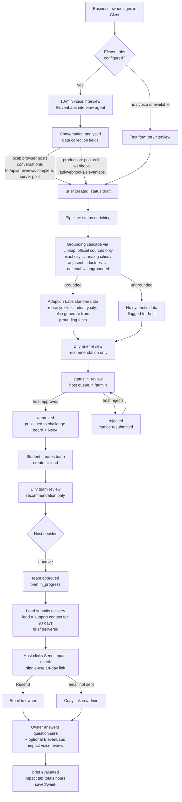
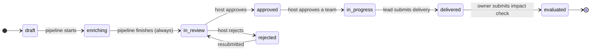
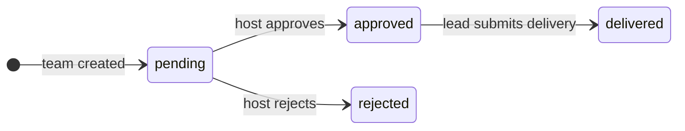
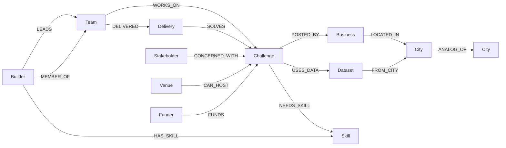

# Architecture

Project Yukikaki is a single Next.js 15 (App Router, TypeScript) app. Pages live under `app/[locale]/…` (`/ja` is the default locale, `/en` the other), API routes under `app/api/…`, and all business logic under `lib/`.

## Core flow



## The four rules

1. **Neon is the source of truth.** Every record lives in Postgres. Neo4j is a derived projection: `lib/graph/sync.ts` writes idempotent `MERGE` statements after approvals and deliveries, and `pnpm graph:rebuild` wipes the graph and replays everything published from the database.
2. **Dify only recommends.** Dify's output is stored in `ai_review` on the brief or team. The only code path that approves or rejects is `decide()` in `lib/decide.ts`, which checks that the caller is a host, validates the transition, writes an audit row in `decisions`, and then syncs the graph.
3. **No ungrounded synthetic data.** `generateGrounded()` in `lib/integrations/adaption.ts` throws `UngroundedError` when there are no grounding facts, and the pipeline only calls Adaption Labs when the grounding level is not `ungrounded`. The generation prompt is built from the grounding sources.
4. **Every external call is guarded and failures are reported, not substituted.** All integrations are called through `withFallback()` in `lib/integrations/_guard.ts`: it applies a timeout (20 s by default), logs a `service_events` row (service, operation, ok, latency, error) and returns an empty value instead of throwing, so the pipeline always finishes. With `REQUIRE_LIVE_SERVICES=true` (live-only mode, `requireLiveServices()` in `lib/env.ts` → `liveOnly` in `lib/pipeline/brief.ts`) a failed live call is written to the brief's `ai_review.issues` instead of being replaced with pre-baked data, and `pnpm check:services` exits non-zero unless all 8 services are live.

## Status machines

Defined once in `lib/workflow/status.ts`; any other transition throws `TransitionError`.





Notes:

- The pipeline (`processBrief` in `lib/pipeline/brief.ts`) always moves a brief to `in_review`, even when every external call failed, so nothing gets stuck in `enriching`. Failures appear as issues on the brief. The pipeline only runs for `draft`/`enriching` briefs, so there is no automatic retry once a brief is `in_review`.
- Teams can only be created for briefs that are `approved` or `in_progress`.

## Grounding cascade

Code: `lib/grounding/search.ts`, `lib/grounding/city-profiles.ts`, `lib/grounding/industry-neighbors.ts`.

Every Linkup query is restricted to **official sources** (`OFFICIAL_DOMAINS` in `lib/grounding/search.ts`): `go.jp` (ministries and agencies), `lg.jp` (prefectures and municipalities), `or.jp` (public bodies), `ac.jp` (universities), plus the city's own site from `CITY_PROFILES` for city-level queries. National queries use `go.jp` only. Results are filtered again by `isOfficial()`: the host must end with an allowed domain, personal pages (`/~user/`) are dropped, and for city-level queries another municipality's site is rejected (e.g. Yokohama's Kanazawa *ward* cannot ground Kanazawa *city*). Blogs and SEO sites never ground a brief.

**`or.jp` is narrowed, not trusted as a whole** (anyone can register an organisation there). An `or.jp` host counts only when its organisation label matches a local public body: social welfare councils (`*-shakyo.or.jp`), chambers of commerce (`*-cci.or.jp`), tourism associations (`*kanko*` / `*kankou*` / `*tourism*`) or city foundations (`*.city-*.or.jp`). For a city-level query the host must *also* contain the city key (`sapporo-cci.or.jp`) or the page title/snippet must name the city. Both are required because a title alone is not enough: a Kagoshima tourism page about a shop called 「札幌ラーメン」 mentions 札幌 but is not a Sapporo source.

The same gate runs on the committed prebaked files: `listPrebaked()`/`loadPrebaked()` pass every source through `isOfficial()` keyed on the source's matched city (and that city's own site) and drop failures, `scripts/validate-seed.ts` fails on any rejected URL or a grounded file with fewer than 2 sources, and `tests/prebaked-provenance.test.ts` asserts both for every file in `seed/prebaked/`.

1. **Exact** — Japanese Linkup queries for the business's own city and industry (statistics/open data, subsidies, DX case studies).
2. **Analog** — the 3 most similar cities from `CITY_PROFILES` (weighted distance on annual snowfall, January temperature, population (log), coastal, tourism and aging ratio), plus the business's city with up to 2 adjacent industries. Example with the bundled table: Sapporo → Asahikawa, Aomori, Nagano.
3. **National** — national statistics (e-Stat) and the SME white paper for the industry.
4. **Ungrounded** — nothing relevant found. The brief is flagged and no synthetic data is generated.

The cascade stops at the first level that returns at least 2 relevant, official, de-duplicated results (up to 6 are kept). A result counts as relevant if it mentions the target city (Japanese or English name, or city key in the URL). Each source is stored in `data_sources` with its `grounding_level` and `matched_city`.

If Linkup cannot be reached at all, live-only mode records the issue "Linkup search failed (live-only mode): no grounding yet…" on the brief; it stays `ungrounded` with no stand-in data, and the host decides.

`seed/prebaked/{slug}.json` is **demo seed data**: `pnpm prebake` produces it by running the live pipeline for the seeded briefs (phase 1: Linkup grounding on official sources and starting/reusing an Adaption dataset per brief; phase 2: waiting for all Adaption datasets in parallel), and `pnpm seed` loads it into the seeded demo briefs. (Only when `REQUIRE_LIVE_SERVICES` is off does the pipeline still borrow these files as labelled "Reference (pre-fetched)" data; don't run that way outside development.)

### Stand-in data (Adaption Labs)

1. Look for an existing succeeded dataset whose name starts with `yukikaki:{industry}:` — the exact `yukikaki:{industry}:{city}` name is preferred, otherwise another city's dataset for the same industry is reused.
2. Otherwise call `POST /api/v1/datasets/invent` with a prompt built from the brief and up to 8 grounding facts (fictional Japanese prompt/completion rows, no real people or contact details). Uses an idempotency key per brief.
3. Wait a short time for rows. If the dataset is still generating, the `data_sources` row is marked `pending` and its rows are fetched later.
4. Payload rows are saved as JSON under `data/synthetic/` and linked from `data_sources.payload_path`; `grounded_on` lists the live sources used.

## Interview ingestion

Both paths are idempotent on the ElevenLabs `conversation_id` (unique column `briefs.elevenlabs_conversation_id`).

- **Local (no tunnel):** when the voice session ends, the browser posts the `conversationId` to `/api/interviews/complete`. The server polls `GET https://api.elevenlabs.io/v1/convai/conversations/{id}` until the status is `done` (up to about 90 s).
- **Production:** ElevenLabs sends a `post_call_transcription` webhook to `/api/webhooks/elevenlabs`. The `ElevenLabs-Signature: t=…,v0=…` header is verified with HMAC-SHA256 over `{t}.{rawBody}` using `ELEVENLABS_WEBHOOK_SECRET` (30-minute tolerance). The event is routed by `agent_id`: `ELEVENLABS_INTERVIEW_AGENT_ID` creates a brief; `ELEVENLABS_IMPACT_AGENT_ID` attaches a voice review to an evaluation.

Browser sessions get a signed URL from `/api/elevenlabs/signed-url?agent=interview|impact` and pass dynamic variables `{user_id, business_id, locale}` (interview) or `{delivery_id}` (impact). Field contract: see [elevenlabs-agents.md](elevenlabs-agents.md).

## Challenge graph (Neo4j)

Built by the pure Cypher builders in `lib/graph/cypher.ts`. Only published records (briefs `approved` and later; teams `approved`/`delivered`) are projected.



- `Builder` = a student user. The lead also has a `MEMBER_OF` edge; each team has exactly one `LEADS` edge (old ones are deleted on lead transfer), mirroring the database constraint.
- `Stakeholder`, `Venue` and `Funder` come from the `entities` table: entities in the same city whose `industries` list is empty or contains the brief's industry.
- `ANALOG_OF` edges link every city in `CITY_PROFILES` to its 2 nearest analogs (written by `graph:rebuild`).

## Data model (Drizzle, `lib/db/schema.ts`)

| Table | Purpose | Key columns |
|---|---|---|
| `users` | Mirror of Clerk users (created lazily on first request) | `clerk_id`, `role` (business/student/host), `display_name`, `email`, `locale`, `skills[]` |
| `businesses` | A business owned by a user | `owner_user_id`, `name`, `city`, `ward`, `industry` |
| `briefs` | Challenge briefs | `slug`, `business_id`, `elevenlabs_conversation_id` (unique), `transcript`, `content` (ja/en title, problem, current_process, desired_outcome), `tools_used[]`, `hours_lost_per_week`, `skills_needed[]`, `data_sensitivity`, `grounding_level`, `status`, `ai_review` |
| `data_sources` | Live sources and synthetic sets per brief | `kind` (live/synthetic), `provider` (linkup/adaption/manual/prebaked), `grounding_level`, `matched_city`, `url`, `snippet`, `grounded_on[]`, `payload_path`, `is_reference`, `external_id`, `pending` |
| `teams` | Student teams | `brief_id`, `name`, `pitch`, `status`, `ai_review` |
| `team_members` | Membership | `team_id`, `user_id`, `role` (lead/member); partial unique index `team_one_lead` = exactly one lead per team |
| `deliveries` | What a team delivered | `team_id`, `brief_id`, `summary` (ja/en), `links[]`, `handover_notes`, `support_contact_user_id` (the lead), `support_until` (+90 days) |
| `feedback_tokens` | Impact-check links | `delivery_id`, `token_hash` (HMAC of the token; raw token only in the link), `expires_at` (+14 days), `used_at`, `sent_to_email`, `email_delivered` |
| `evaluations` | Owner's impact answers (one per delivery) | `hours_saved_per_week`, `satisfaction` (1–5), `still_in_use`, `issues`, `would_recommend`, `impact_conversation_id`, `impact_transcript`, `impact_summary` |
| `entities` | Local stakeholders, venues, funders | `kind`, `name` (ja/en), `city`, `ward`, `industries[]` |
| `decisions` | Audit log of host decisions | `subject_type` (brief/team), `subject_id`, `decided_by`, `decision`, `note` |
| `service_events` | One row per external call | `service`, `operation`, `ok`, `latency_ms`, `error` |

Database connection (`lib/db/index.ts`): Neon serverless driver via `DATABASE_URL` (create the Neon project in `aws-ap-southeast-1`, the closest region to Japan). With `DATABASE_URL` empty (local development only; refused on Vercel) it uses embedded PGlite in `./.data/pglite`, registered at server start by `instrumentation.ts` → `lib/db/register-pglite.ts`. Tests use in-memory PGlite (`PGLITE_DIR=memory://`) with the same schema and queries.

## Roles and auth

- Clerk (v7) handles sign-in. Insert your own production keys into your .env.local variables — Yukikaki does not use Clerk keyless dev mode. `ensureUser()` (`lib/auth.ts`) mirrors the Clerk user into `users` on first request — no Clerk webhook needed.
- Without both Clerk keys (`authEnabled()` in `lib/env.ts` is false), sign-in is off: `middleware.ts` runs only next-intl and sends `/sign-in` and `/sign-up` to `/[locale]/auth-setup`, the layout skips `<ClerkProvider>`, the header shows "Sign-in not configured", `ensureUser()` returns `null` without calling Clerk, `requireUser()`/`requireRole()` redirect to `/[locale]/auth-setup`, and auth-only API routes return 401. Public pages keep working.
- Emails listed in `HOST_EMAILS` become `host` automatically. Other users pick `business` or `student` during onboarding; host can never be self-selected.
- Sign-in is enforced where data is accessed, not by middleware path matching: `requireUser()`/`requireRole()` in the pages and server actions for `/admin`, `/interview`, `/teams`, `/me`, `/onboarding` and `/events/new`, and `auth()` in API routes. Role checks (host-only admin, lead-only delivery and lead transfer) happen on the server.

## Service failures (live-only mode)

All 8 services are required. When a call fails at runtime, nothing is silently replaced:

| Service | What happens on failure |
|---|---|
| Linkup | Issue on the brief ("Linkup search failed (live-only mode)…"); brief stays `ungrounded`, no stand-in data |
| Adaption Labs | Issue on the brief ("Adaption Labs call failed (live-only mode)…"); grounding sources are kept |
| Dify | `ai_review.error = "AI review unavailable: …"`; skills inferred by keyword rules (`lib/skills.ts`); host still decides |
| Neo4j | Graph panels show "Graph unavailable"; builder suggestions computed in SQL; if the Aura Free instance is paused, resume it from the Aura console; fix with `pnpm graph:rebuild` (also restores the graph onto a new instance) |
| ElevenLabs | Voice unavailable; the owner can use the text form on `/interview` |
| Resend | Email not sent; link shown in `/admin` with a Copy button |
| Neon, Clerk | Required in production. Locally, an empty `DATABASE_URL` uses embedded PGlite; without Clerk keys sign-in is off and only public pages work |

`pnpm check:services` checks all 8; `pnpm tsx scripts/inspect-latest.ts` shows the newest brief's sources, stand-in data, AI review and the `service_events` since it was created.

## Directory map

```
app/                    Next.js App Router
  [locale]/             Pages for /ja and /en (landing, interview, challenges, teams, admin, feedback …)
  api/                  Route handlers (interviews/complete, webhooks/elevenlabs, elevenlabs/signed-url, …)
dify/                   Importable Dify workflows (brief-review.yml, team-review.yml)
docs/                   This documentation
drizzle/                SQL migrations (applied by pnpm db:push)
emails/                 Bilingual impact-check email template
i18n/                   next-intl routing (ja default, en)
lib/
  auth.ts               Clerk → users mirror, roles, HOST_EMAILS
  decide.ts             The only approve/reject path (host decisions + audit)
  env.ts                Validated environment, `configured.*` checks, `requireLiveServices()`
  feedback.ts           Impact-check tokens, evaluations, impact voice reviews
  teams.ts              Teams, lead transfer, delivery, Dify team review
  skills.ts             Skill vocabulary + keyword fallback
  seed-schema.ts        Shape of the seed file
  datasets/store.ts     Synthetic payload files (data/synthetic)
  db/                   Drizzle schema + Neon/PGlite connection
  graph/                Neo4j client, Cypher builders, sync + rebuild
  grounding/            City profiles, industry neighbours, Linkup cascade (official sources only), demo seed data loader
  integrations/         _guard (withFallback), adaption, dify, elevenlabs, email (Resend), linkup
  pipeline/brief.ts     draft → enriching → in_review pipeline
  workflow/status.ts    Status machines
scripts/                CLI scripts (db-migrate, seed, prebake, graph-rebuild, check-services, setup-elevenlabs, build-dify, smoke-dify, inspect-latest)
seed/                   Demo seed data (seed.json + seed/prebaked/*.json)
tests/                  Vitest tests
middleware.ts           Clerk + next-intl middleware
```
